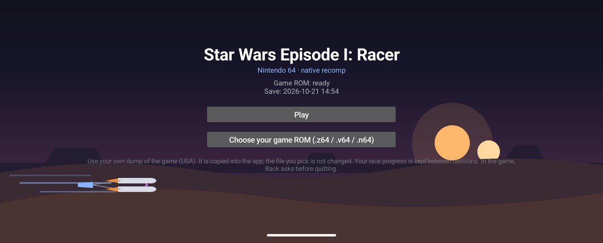
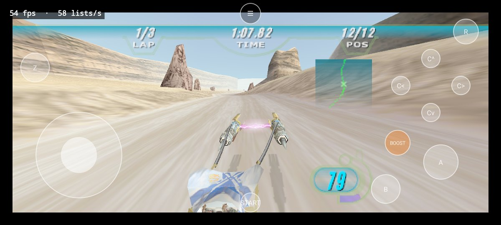
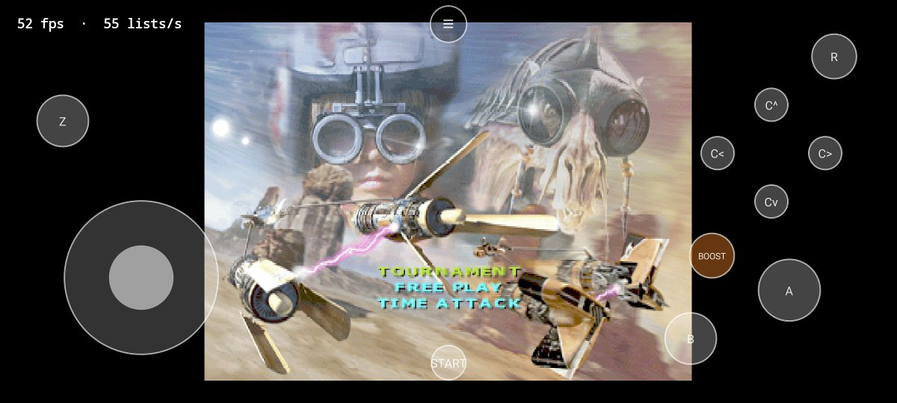
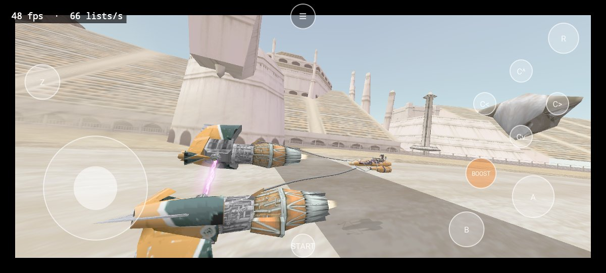
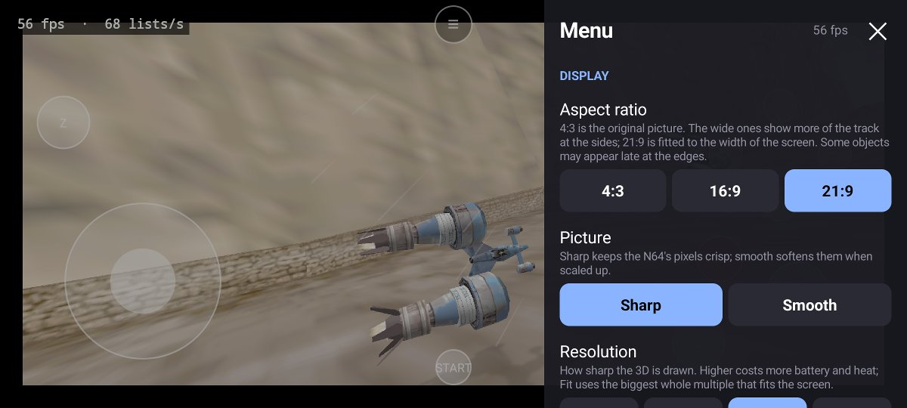
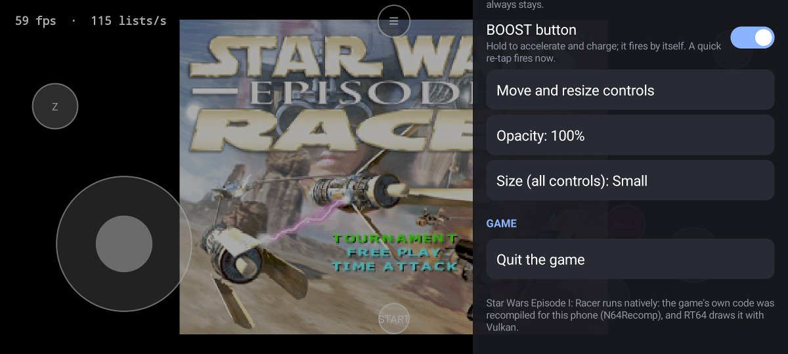
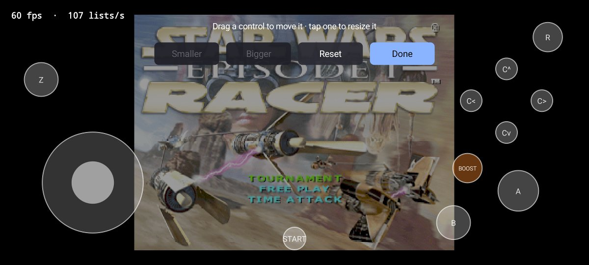
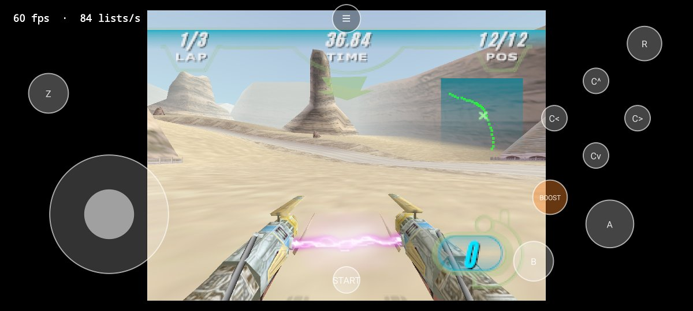
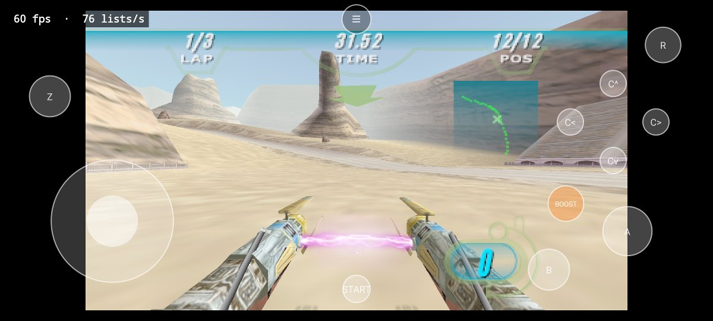
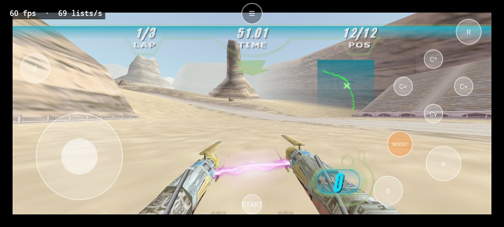

# Star Wars Racer Recomp

A native Android port of **Star Wars Episode I: Racer** (Nintendo 64), made by *static recompilation*: the game's own
MIPS code is translated to C with [N64Recomp](https://github.com/N64Recomp/N64Recomp) and compiled ahead of time for
the phone, instead of being emulated. Graphics go through [RT64](https://github.com/rt64/rt64) on Vulkan, and the
console's OS layer comes from [N64ModernRuntime](https://github.com/N64Recomp/N64ModernRuntime).

It is built on **[sp00nznet/racer](https://github.com/sp00nznet/racer)**, sp00nznet's N64Recomp project for this game:
the map of the game's functions, the recompiler setup and the runtime glue all come from there (see
[Credits](#credits-and-licence)). This repository adds the Android app and the fixes that took it from "display lists
reach the renderer" to a moving picture on a phone.

> **This repository contains no game data.** You recompile the game from your own legally dumped cartridge, and
> nothing made from it is ever committed or shared. Please do not share the APKs you build (they contain the game).

## Status

Work in progress, but playable. On a Google Pixel 8 a full Tournament race plays start to finish with the touch
pad, in 4:3, 16:9 or 21:9, with sound, and the progress saves and loads again after the app is closed.

| Part | State |
|---|---|
| Boot, game loop, asset loading | works |
| Picture (RT64 on Vulkan, Mali-G715) | works: textures correct, true widescreen; 50-60 fps (1x holds ~60, 3x at 21:9 ~50 on a warm phone) |
| ROM import (system file picker) | works |
| On-screen touch pad | works (menus and a full race); every button checked; L removed (Racer does not use it); BOOST button (hold: accelerates, charges and fires whenever the game says the boost is ready) |
| Gamepad | implemented, not tested |
| Sound (audio microcode recompiled with RSPRecomp) | works; not yet checked for crackle or drift over long play |
| Saves (16 Kbit EEPROM) | works: Tournament progress survives closing the app |
| Home / app switch / screen lock | works: the game resumes where it was; landscape only |
| Start screen (ROM picker, Play) | works |
| Side menu: aspect 4:3 / 16:9 / 21:9 (true widescreen), sharp / smooth, resolution, FPS counter, pad options | works (in widescreen the HUD and menus stay 4:3-wide in the middle) |
| Pad editor (move and resize every control) | works |
| Save states, HUD out at the wide edges | planned: [docs/UI-WISHLIST.md](docs/UI-WISHLIST.md) |

Every fix it took is listed with its cause in [docs/ANDROID-FIXES.md](docs/ANDROID-FIXES.md).

## Screenshots

Pixel 8, 2400x1080. The FPS counter in the corner is the menu's optional overlay.

| | |
|---|---|
|  |  |
| **Start screen:** pick your own ROM, then Play | **Racing in 21:9**, HUD at its real width |
|  |  |
| **Title menu** (menus stay 4:3) | **Attract demo** in 21:9 |
|  |  |
| **Side menu:** aspect ratio, sharp / smooth, resolution | **Controls:** pad, BOOST, editor, opacity, size, quit |
|  | |
| **Pad editor:** drag to move, tap to resize | |

The same spot in each aspect ratio:

| 4:3 | 16:9 | 21:9 |
|---|---|---|
|  |  |  |

Game footage is from the author's own cartridge dump and shown only to illustrate the port; the game itself belongs
to its rights holders and is not part of this repository.

## Tested on

- **Phone:** Google Pixel 8 (Mali-G715, Android 16). Other arm64 phones with Vulkan should work but have not been tried.

## What you need

- **Your own copy of the game:** a dump of the USA cartridge. Check a `.z64` with
  `certutil -hashfile <file> SHA1` (Windows) or `sha1sum <file>`:

  | Dump | SHA-1 |
  |---|---|
  | Star Wars Episode I: Racer (USA), `.z64` | `3542d5597c8a56ea8f5c63bceae97a24c4c08d58` |

  A `.v64` or `.n64` dump of the same cartridge works too: the build converts it.
- **A Windows 10 or 11 PC** with about 15 GB free and an internet connection for the first build. (The build is
  written and tested for Windows only.)
- **An Android phone:** Android 7 or newer, arm64, with Vulkan, and a USB cable.

## Building it

Everything below runs in **PowerShell** on Windows.

### 1. Install the tools (once)

| Tool | Get it from | Notes |
|---|---|---|
| Git | [git-scm.com](https://git-scm.com/download/win) | default options |
| Python 3 | [python.org](https://www.python.org/downloads/) | tick **"Add python.exe to PATH"** in the installer |
| LLVM-MinGW (clang) | [mstorsjo/llvm-mingw releases](https://github.com/mstorsjo/llvm-mingw/releases) | the `llvm-mingw-...-ucrt-x86_64.zip`; unzip it to `C:\llvm-mingw` (so `C:\llvm-mingw\bin\clang.exe` exists) |
| Android Studio | [developer.android.com/studio](https://developer.android.com/studio) | brings Java and the Android SDK |

In Android Studio, open **Tools > SDK Manager** (on the welcome screen: **More Actions > SDK Manager**):

- **SDK Platforms:** Android 15 (API 35).
- **SDK Tools:** tick **Show Package Details**, then install **NDK (Side by side) 28.2.13676358**,
  **CMake 3.22.1** and **Android SDK Platform-Tools**.

### 2. Get the code

```powershell
git clone --recursive https://github.com/dguillot-gh/star-wars-racer-recomp.git
cd star-wars-racer-recomp
```

`--recursive` also fetches RT64, N64ModernRuntime, N64Recomp and SDL2 (into `lib/`).

### 3. Build it

```powershell
.\build.ps1 -Rom "C:\path\to\Star Wars Episode I - Racer (USA).z64"
```

`build.ps1` does the rest and tells you plainly when something is missing:

1. checks the tools from step 1 (it finds them in their default install folders);
2. copies your ROM to `baserom.z64` (converting a `.v64` / `.n64` dump to `.z64`) and checks its SHA-1;
3. builds N64Recomp and RSPRecomp from `lib/` (once, about half a minute);
4. recompiles the game from your ROM (under a minute; only again when the ROM or the recompiler inputs change);
5. builds the app: the first time this downloads Gradle and the Android libraries and compiles the whole game,
   which took **about 40 minutes** on a laptop; later builds only redo what changed;
6. installs it if a phone is connected over USB (see step 4).

Later, after `git pull`, just run `.\build.ps1` again (the ROM is remembered). Add `-NoInstall` to only build.
If PowerShell says running scripts is disabled, run it as
`powershell -ExecutionPolicy Bypass -File .\build.ps1 -Rom "..."`.

The game code it writes (`RecompiledFuncs/`, `rsp/aspMain.cpp`) and the APK
(`android\app\build\outputs\apk\debug\app-debug.apk`) are made from your ROM: they are ignored by Git and must not be
shared.

### 4. Install it and play

1. On the phone, turn on USB debugging: **Settings > About phone**, tap **Build number** seven times, then
   **Settings > System > Developer options > USB debugging**.
2. Connect the phone and allow the computer when it asks. `build.ps1` installs the app by itself when the phone is
   connected; to install by hand: `adb install -r android\app\build\outputs\apk\debug\app-debug.apk`
   (`adb` is in `%LOCALAPPDATA%\Android\Sdk\platform-tools`).
3. Copy your ROM to the phone too (for example into Downloads). Open **Star Wars Episode I: Racer**, tap
   **Choose your game ROM**, pick it, then **Play**. The app accepts `.z64`, `.v64` and `.n64`.

### Step by step (what build.ps1 runs)

For anyone who wants to run the parts by hand. First point PowerShell at the tools (default install folders):

```powershell
$env:ANDROID_HOME = "$env:LOCALAPPDATA\Android\Sdk"
$env:JAVA_HOME = "C:\Program Files\Android\Android Studio\jbr"
$env:PATH = "C:\llvm-mingw\bin;$env:ANDROID_HOME\cmake\3.22.1\bin;$env:ANDROID_HOME\platform-tools;$env:PATH"
```

**ROM.** Put a `.z64` dump in the repository folder as `baserom.z64` (`python tools/rom_to_z64.py <your dump>`
converts and copies any byte order) and check it: `certutil -hashfile baserom.z64 SHA1` must print
`3542d5597c8a56ea8f5c63bceae97a24c4c08d58`.

**Recompilers** (once; the `-include cstdlib` flag works around a missing `#include` in N64Recomp's bundled
rabbitizer library that current clang versions reject):

```powershell
cmake -S lib/N64ModernRuntime/N64Recomp -B build/recomp-tools -G Ninja -DCMAKE_BUILD_TYPE=Release -DCMAKE_C_COMPILER=clang -DCMAKE_CXX_COMPILER=clang++ "-DCMAKE_CXX_FLAGS=-include cstdlib"
cmake --build build/recomp-tools --target N64RecompCLI RSPRecomp
```

**Game code from your ROM** (again after changes to `symbols.toml`, `recomp.toml` or `tools/`):

```powershell
.\build\recomp-tools\N64Recomp.exe recomp.toml
python tools/fix_fallthroughs.py
python tools/post_recomp_patches.py
python tools/gen_lookup_table.py
New-Item -ItemType Directory -Force rsp | Out-Null
.\build\recomp-tools\RSPRecomp.exe aspMain.toml
```

N64Recomp prints a few `[Warn]` / `[Info]` lines; those are expected. The scripts should report
`chained to continuation: 143`, `post-recomp redirects applied: 25` and `1409 function entries`, and `git status`
should show no changed files afterwards.

**App:**

```powershell
cd android
.\gradlew.bat :app:assembleDebug
```

### If something goes wrong

| Message | Fix |
|---|---|
| `build.ps1` stops with `STOPPED: ...` | the message says what is missing and where to get it |
| `clang` or `ninja` not found (by hand) | run the three `$env:` lines above in this window |
| NDK not found, or `NDK ... did not have a source.properties file` | install exactly NDK **28.2.13676358** (step 1) |
| `SDK location not found` | `$env:ANDROID_HOME` is not set in this window |
| `gradlew.bat` is blocked (some company PCs block `cmd.exe`) | use `build.ps1`, or run `& "$env:JAVA_HOME\bin\java.exe" -classpath gradle\wrapper\gradle-wrapper.jar org.gradle.wrapper.GradleWrapperMain :app:assembleDebug` in `android\` |
| `INSTALL_FAILED_UPDATE_INCOMPATIBLE` | the phone has a copy signed on another PC: uninstall it first (this deletes its saves) |
| `adb: no devices` | USB debugging is off, or the phone is still asking to allow this computer |

## What the build does to your PC

Apart from the tools you installed, it only writes inside the repository folder and Gradle's cache: N64Recomp reads
your ROM (never changes it) and writes `RecompiledFuncs/`; the recompilers build into `build/`; Gradle builds into
`android/app/build/` and, the first time, downloads itself and the Android libraries (from Gradle, Google and Maven
Central) into `%USERPROFILE%\.gradle`. Nothing is uploaded, and nothing is left running.

## How it works

- `symbols.toml` lists the game's ~1,400 functions and `recomp.toml` says which ones are replaced by the runtime.
  N64Recomp turns each into a C function.
- `tools/post_recomp_patches.py` routes the game's own copies of some libultra functions (thread priority, messages,
  VI, controller, EEPROM, PI reads) to N64ModernRuntime, because the copies only update the game's private state.
- `src/main.cpp` is the host: ROM loading, the memory guard for device registers and bad pointers, saves, input.
  `src/rt64_render_context.cpp` hands display lists to RT64.
- `android/` is the Gradle app: an SDL2 activity, the ROM picker and the touch pad.

## Made with AI assistance

This port was built with AI help: the project owner worked with Qwen (a local model) and Claude (Anthropic), which found and wrote most of the fixes. Each fix in
[docs/ANDROID-FIXES.md](docs/ANDROID-FIXES.md) says who found it. Everything was tested on a real phone, but expect
rough edges, and please report what you find.

## Credits and licence

- **[sp00nznet/racer](https://github.com/sp00nznet/racer)** by sp00nznet: the original N64Recomp project for this game.
  From it this port uses the function map (`symbols.toml`), the recompiler config (`recomp.toml`), the host program
  (`src/main.cpp`, `src/rt64_render_context.cpp`, `src/audio.cpp`, `src/section_table.cpp`), the build files and the
  regen tools (`tools/fix_fallthroughs.py`, `tools/gen_lookup_table.py`, `tools/post_recomp_patches.py`). All of these
  were changed for Android; its other analysis tools are kept as they were. Its README is kept as
  [docs/ORIGINAL-README.md](docs/ORIGINAL-README.md).
- N64Recomp and N64ModernRuntime (Mr-Wiseguy and contributors), RT64 (DarioSamo and contributors), and AurelioB's
  Android forks of them, which the submodules here fork again with this port's patches. More in
  [NOTICE.md](NOTICE.md) and [CREDITS.md](CREDITS.md).

MIT ([LICENSE](LICENSE)), as sp00nznet's project; the licence's Scope section explains what it cannot cover.
*Star Wars Episode I: Racer* is © Lucasfilm Ltd.; this project is not affiliated with or endorsed by Lucasfilm,
LucasArts, Disney or Nintendo.
